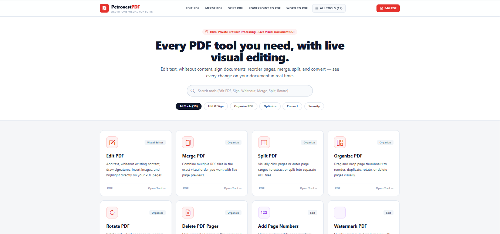

# Petrovest PDF

All-in-one visual PDF editor, document converter, and PDF security suite built on a zero-latency split-compute architecture.



## Architecture

Petrovest PDF splits workloads across two tiers so core PDF operations run instantaneously on the client with zero server overhead, while heavy Office and cryptographic jobs run on a dedicated containerized worker:

1. **Static Edge Frontend (`petrovest.top`)**
   * Serves all 19 tool interfaces globally with zero cold start[cite: 1].
   * Executes client-side PDF rendering, visual canvas editing, page manipulation, image conversion, and compression locally in the browser using `pdf.js`, `pdf-lib`, `jsPDF`, `SheetJS`, `Mammoth`, and `html2pdf.js`.
2. **Conversion & Security Worker (`petrovestpdf-worker.onrender.com`)**
   * Stateless FastAPI container (`backend/`) equipped with **LibreOffice** (Writer, Calc, Impress), **`pdf2docx`**, **Ghostscript**, and **`qpdf`**.
   * Uses isolated per-job LibreOffice user profiles (`-env:UserInstallation`) and an async concurrency semaphore (`MAX_CONCURRENT_JOBS`) to prevent process lock collisions and memory spikes.
   * Includes automatic client-side fallbacks across Office conversion tools.

---

## Tool Suite (19 Tools)

| Category | Tools | Execution Engine |
| :--- | :--- | :--- |
| **Edit & Sign** | Edit PDF, Add Page Numbers, Watermark PDF | Browser (`pdf.js` + `pdf-lib` canvas)[cite: 1] |
| **Organize PDF** | Merge PDF, Split PDF, Organize PDF, Rotate PDF, Delete PDF Pages | Browser (`pdf.js` + `pdf-lib`)[cite: 1] |
| **Optimize** | Compress PDF | Browser (`pdf-lib` object/stream optimization) |
| **Convert** | PowerPoint to PDF, Excel to PDF, Word to PDF, PDF to Word, JPG/PNG to PDF, PDF to JPG, HTML to PDF, PDF to Text | LibreOffice / `pdf2docx` Worker + Browser Fallback |
| **Security** | Protect PDF (AES-256 + permissions), Unlock PDF | `qpdf` Worker |

---

## Repository Structure

```text
petrovestpdf/
├── index.html                  # Main landing page & live tool search/filter
├── favicon.svg                 # Vector brand favicon
├── robots.txt                  # Search engine crawl rules
├── sitemap.xml                 # XML sitemap covering all 19 tools
├── llms.txt                    # AI search & crawler index manifest
├── assets/
│   ├── Screenshot.png          # UI preview screenshot
│   ├── css/
│   │   └── app.css             # Shared design system & studio workspace layout
│   └── js/
│       ├── site-config.js      # Centralized brand, API URL, nav chrome & SEO injection
│       └── pdf-engine.js       # Shared pdf.js renderer, download helper & worker client
├── tools/                      # 19 standalone visual tool workspaces
│   ├── edit-pdf.html
│   ├── merge-pdf.html
│   ├── split-pdf.html
│   ├── organize-pdf.html
│   ├── rotate-pdf.html
│   ├── delete-pages.html
│   ├── page-numbers.html
│   ├── watermark-pdf.html
│   ├── compress-pdf.html
│   ├── pptx-to-pdf.html
│   ├── excel-to-pdf.html
│   ├── word-to-pdf.html
│   ├── pdf-to-word.html
│   ├── jpg-to-pdf.html
│   ├── pdf-to-jpg.html
│   ├── html-to-pdf.html
│   ├── pdf-to-text.html
│   ├── protect-pdf.html
│   └── unlock-pdf.html
└── backend/                    # Dockerized FastAPI + LibreOffice + qpdf worker
    ├── Dockerfile
    ├── requirements.txt
    └── main.py
